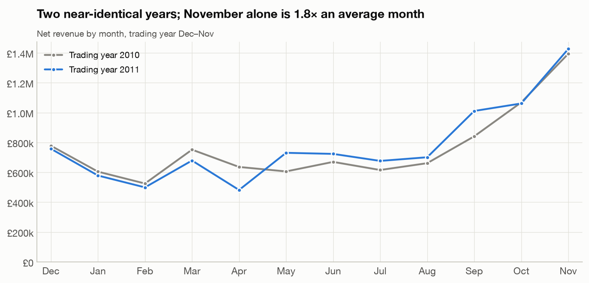
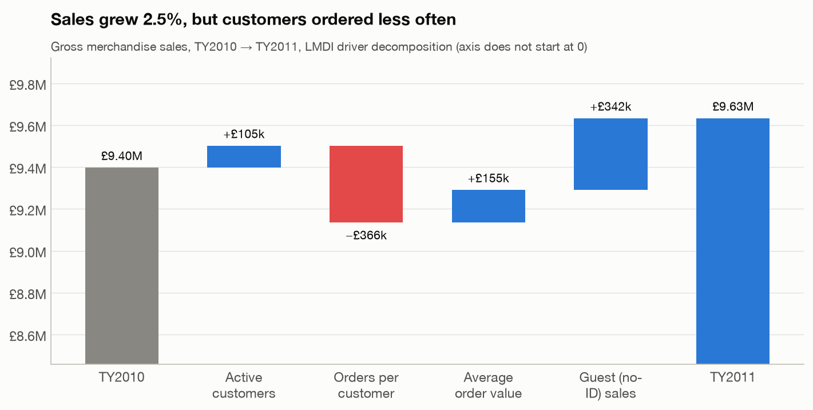
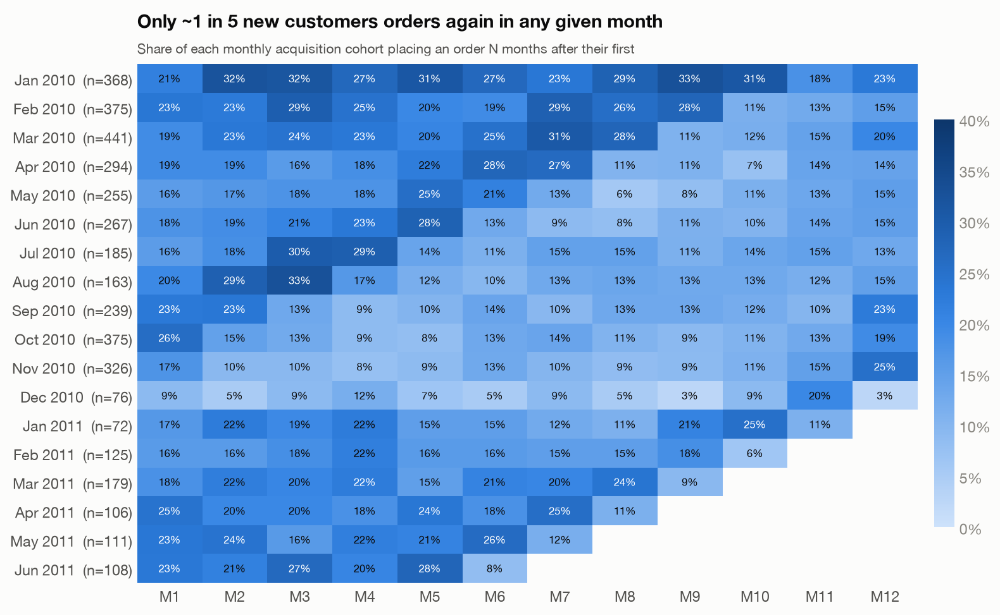
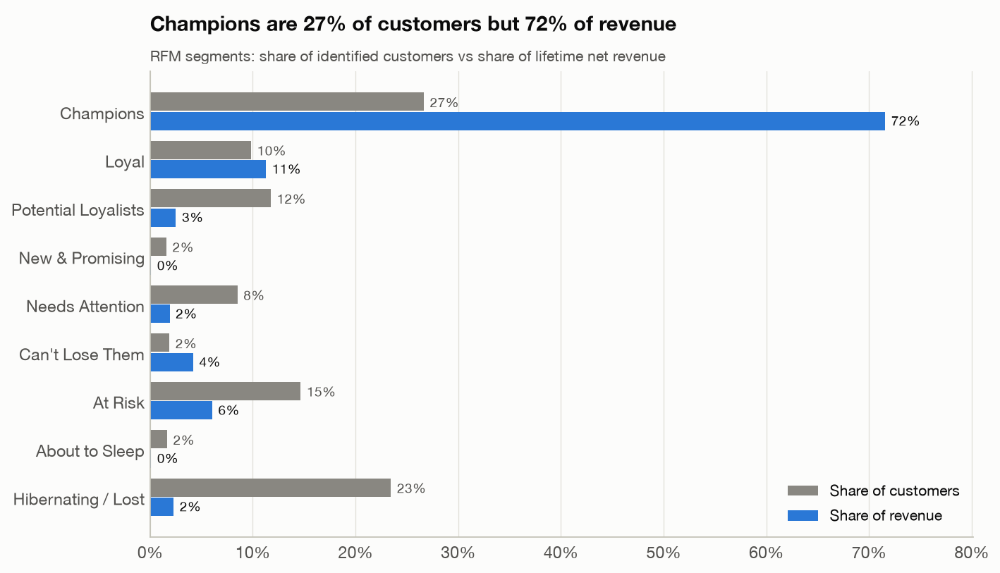
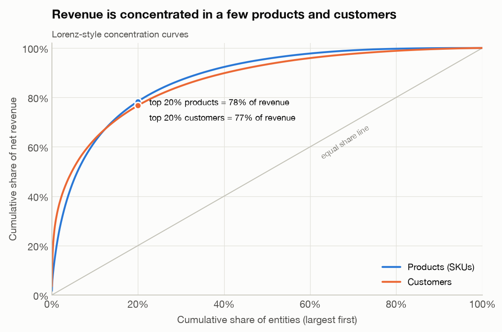
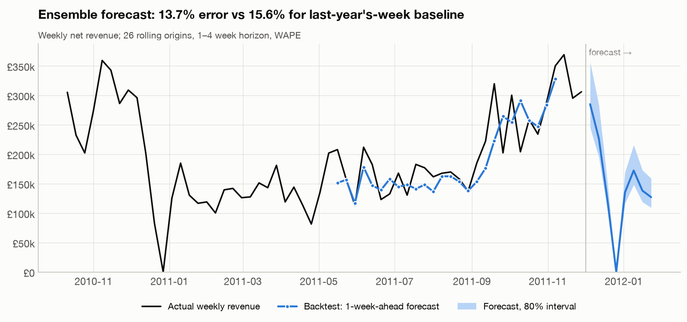
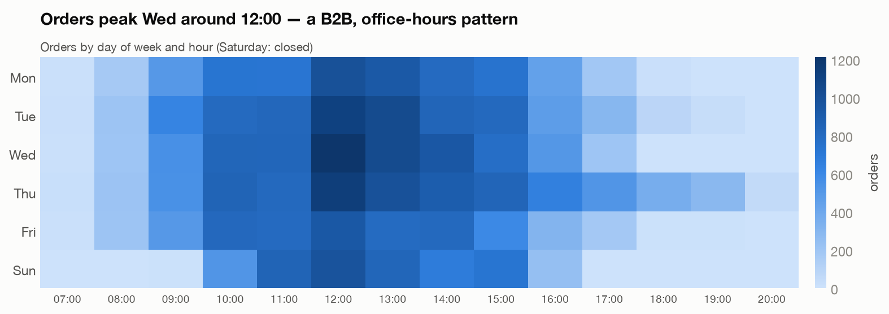
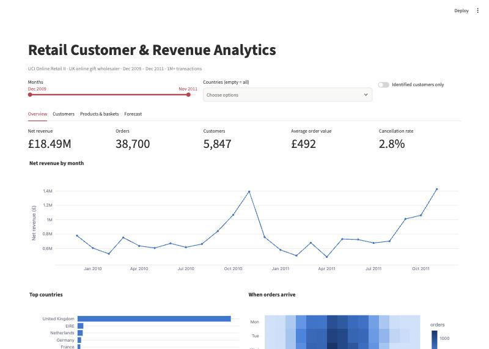

# Retail Customer & Revenue Analytics

**End-to-end analysis of 1M+ real transactions from a UK online retailer — from a messy Excel export to a SQL warehouse, customer segments, a validated lifetime-value model, basket analysis, a backtested forecast and an interactive dashboard.**

   

> **TL;DR** — Revenue grew 1.9% to £9.33M, but the business is quietly running on its existing customers: **first-time customer sales fell 54%**, existing customers **ordered 4% less often**, and new cohorts are retaining worse. 27% of customers ("Champions") bring in 72% of revenue. A from-scratch **BG/NBD lifetime-value model** predicts next-period purchases **within 1.5%** out-of-sample, and basket analysis shows customers **buy collections, not items** — the basis for six concrete recommendations.

**[Executive summary](reports/executive_summary.md)** · **[Methodology & decisions](docs/methodology.md)** · **[Metric definitions](docs/metric_definitions.md)** · **[Data-quality report](docs/data_quality_report.md)** · **[Walkthrough notebook](notebooks/retail_analytics_walkthrough.ipynb)**

---

## Business questions

1. **Is the business growing — and what is actually driving revenue?**
2. **Who are the customers, how loyal are they, and who is about to leave?**
3. **How much will each customer be worth next year?**
4. **Which products sell together?**
5. **What will next month's revenue be, and how much should we trust that number?**

## Headline results

| Area | Result |
|---|---|
| Data quality | 1,067,371 raw rows → 1,003,340 clean sale lines. Found the two Excel sheets **overlap by 9 days (22.5k rows, £377k double-counted)** plus 11.8k duplicate lines |
| Growth | Net revenue **£9.16M → £9.33M (+1.9%)**; orders per customer **4.29 → 4.11**; AOV **£476 → £508** |
| Acquisition | First-time-customer sales **−54%** YoY (Jan–Nov); first-time customers 3,288 → 1,509 |
| Retention | ~**21%** of new customers re-order in month 1; 6-month retention **22% → 17%** (2010 vs 2011 H1 cohorts) |
| Concentration | Top 20% of customers = **77%** of revenue; top 20% of products = **78%** |
| Segments | **Champions: 27% of customers, 72% of revenue.** 966 At-Risk / Can't-Lose customers hold **£399k** of predicted next-year revenue |
| Lifetime value | BG/NBD predicted **7,605** holdout purchases vs **7,721** actual (−1.5%); per-customer error **38% lower** than a run-rate baseline |
| Basket analysis | 534 product-pair rules on 39k baskets; **88%** of the top 50 are sibling designs; strongest lift **46×** |
| Forecasting | Weekly ensemble: **13.7% WAPE** vs 15.6% for "same week last year" (−12%), 26-origin rolling backtest |

---

## 1 · Data cleaning: what a naive load gets wrong


The raw export mixes sales with cancellations, postage, bad-debt write-offs and warehouse notes, and **both yearly sheets contain 1–9 Dec 2010**. Every row is kept and classified with a `line_type` rather than silently dropped, cancellations are matched back to the exact sale they reversed (`merge_asof`), and every rule is logged with the rows and revenue it touches → [data-quality report](docs/data_quality_report.md).

## 2 · Revenue: flat on the surface, shifting underneath





A driver-based **revenue bridge** (LMDI decomposition, so the bars add up exactly) shows the 2.5% growth in gross sales came *despite* customers ordering less often. And the mix is moving away from new customers:


## 3 · Customers: cohorts, segments, concentration





Nine **RFM segments** (rules kept as reviewable data, each with a recommended action), cross-checked with **k-means** (silhouette-optimal k = 4 recovers the same structure). Revenue is highly concentrated:



## 4 · Customer lifetime value — validated out of sample


**BG/NBD + Gamma-Gamma implemented from scratch** with SciPy (and unit-tested by recovering known parameters from simulated customers). Two lessons are documented in the [methodology](docs/methodology.md#6-customer-lifetime-value-bgnbd--gamma-gamma): the unbounded optimiser chased floating-point noise to a nonsense optimum, and a 12-month calibration window over-forecast by 54% because Q4-acquired customers look like heavy buyers — 18 months fixes it.


## 5 · Market-basket analysis


Association rules from one sparse matrix product (`Xᵀ X`) over 39k baskets. The strongest associations are almost all **sibling designs** — a "complete the collection" recommendation and bundling opportunity.

## 6 · Forecasting with an honest backtest



| Model (26 rolling origins, 1–4 weeks ahead) | WAPE | Bias |
|---|---:|---:|
| **Ensemble (seasonal naive + harmonic)** | **13.7%** | −5.6% |
| Harmonic regression (Fourier + trading days) | 15.4% | −5.1% |
| Seasonal naive (same week last year) | 15.6% | −6.2% |
| Run-rate (last 4 weeks) | 18.8% | −11.7% |
| Damped Holt (exp. smoothing) | 18.8% | −8.5% |

## 7 · Operations & markets




## 8 · Interactive dashboard

`make dashboard` launches a Streamlit app on the warehouse: KPI tiles, filters for month range / country / identified customers, cohort heatmap, segment actions, a **cross-sell explorer** and the forecast.




---

## Recommendations

1. **Track new-customer acquisition as a KPI** and find what changed in 2011 — first-time sales halved.
2. **Run a second-order programme** (nudge at day 30, offer at day 60), tested as an A/B experiment — only ~21% of new customers return in month 1 and the median re-order gap is 32 days.
3. **Personal outreach to the 110 "Can't Lose Them" accounts** — £6.2k average lifetime spend, repeat buyers' median P(alive) 38%.
4. **"Complete the collection" recommendations and bundles** — sibling designs show 34–46× lift.
5. **Plan Q4 stock and staffing on the weekly forecast**; schedule campaigns Tue–Thu late morning.
6. **Investigate cancellations in Spain (13%) and capture an ID on guest orders (13% of sales).**

Full reasoning and success metrics: [executive summary](reports/executive_summary.md).

---

## How it's built

```
raw Excel (UCI) ──► ingest.py ──► cleaning.py ──► Parquet ──► sql/*.sql ──► DuckDB warehouse
                    (types)      (audit + flags)              (star schema + KPI views)
                                                                   │
            ┌───────────────┬───────────────┬──────────────┬───────┴───────┬───────────────┐
         revenue.py     cohorts.py    segmentation.py     clv.py        basket.py    forecasting.py
            └───────────────┴───────────────┴──────┬───────┴───────────────┴───────────────┘
                                                   ▼
                     figures/*.png · tables/*.csv · metrics.json · dashboard · notebook
```

| Layer | What's in it |
|---|---|
| **SQL** ([`sql/`](sql)) | Star schema (2 facts, 3 dimensions) and 8 analysis views using CTEs, window functions (`LAG`, running sums, `ROW_NUMBER`), `FILTER` aggregates and date logic |
| **Python** ([`src/retail_analytics/`](src/retail_analytics)) | pandas / NumPy / SciPy / statsmodels / scikit-learn; one module per analysis, no notebooks-as-code |
| **Statistics & ML** | LMDI decomposition, cohort analysis, RFM + k-means (silhouette), BG/NBD + Gamma-Gamma MLE, association rules, harmonic regression, rolling-origin backtesting |
| **Quality** | 28 pytest tests on hand-built fixtures (no dataset needed), GitHub Actions CI, deterministic byte-identical outputs |
| **Communication** | Takeaway-first charts in a colour-blind-safe palette, executive summary, Streamlit dashboard, executed notebook |

### Repository layout

```
├── sql/                      # 01–06 star schema, 10–17 KPI & analysis views
├── src/retail_analytics/     # ingest, cleaning, warehouse, revenue, cohorts, segmentation,
│                             # clv, basket, forecasting, figures, pipeline
├── dashboard/app.py          # Streamlit dashboard
├── notebooks/                # executed walkthrough notebook
├── reports/
│   ├── executive_summary.md
│   ├── figures/              # every chart above
│   ├── tables/               # the numbers behind every chart (CSV)
│   └── metrics.json          # single source for every number quoted here
├── docs/                     # methodology, metric definitions, data dictionary, DQ report
└── tests/                    # pytest suite
```

## Run it yourself

```bash
python -m venv .venv && source .venv/bin/activate
make install     # pip install -e ".[dashboard,notebook,dev]"
make data        # downloads the UCI dataset (~45 MB) and converts it to Parquet
make all         # clean → warehouse → analyses → figures + metrics.json  (~20 s)
make test        # 28 tests, ~3 s
make dashboard   # http://localhost:8501
```

## Data

**[UCI Online Retail II](https://archive.ics.uci.edu/dataset/502/online+retail+ii)** — Chen, D. (2019), UCI Machine Learning Repository, [doi:10.24432/C5CG6D](https://doi.org/10.24432/C5CG6D), CC BY 4.0. All transactions of a UK-based online giftware retailer, 01-Dec-2009 to 09-Dec-2011; many customers are wholesalers. The data is downloaded by `make data` and not committed.

## Limitations & next steps

- **Left-censoring:** the data starts Dec-2009, so 2010 "new customer" counts are an upper bound.
- **No cost data:** CLV and recommendations are revenue-based, not margin-based.
- **Correlation, not causation:** basket rules and the retention gap motivate experiments; they don't prove what an intervention would do. Next step: an A/B test of the second-order programme.
- **Forecast horizon:** two years of history supports short-horizon weekly forecasts; a longer series would justify full seasonal models (e.g. SARIMA / Prophet) and holiday effects per country.
- **Next:** product-category taxonomy from descriptions (NLP), price-elasticity by SKU, and MBG/NBD to give one-time buyers a non-trivial P(alive).

---

<sub>MIT licence · Built with Python 3.13, DuckDB, pandas, SciPy, statsmodels, scikit-learn, matplotlib, Plotly and Streamlit.</sub>
