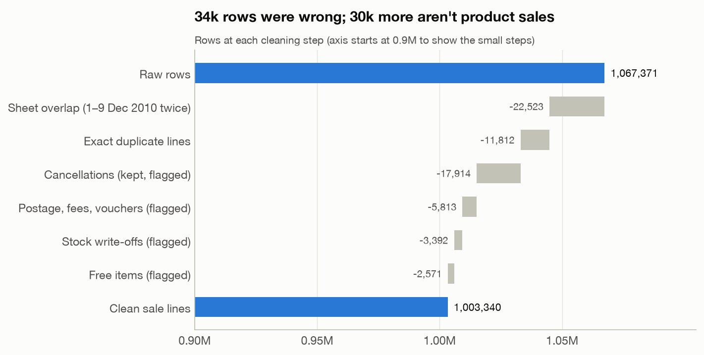
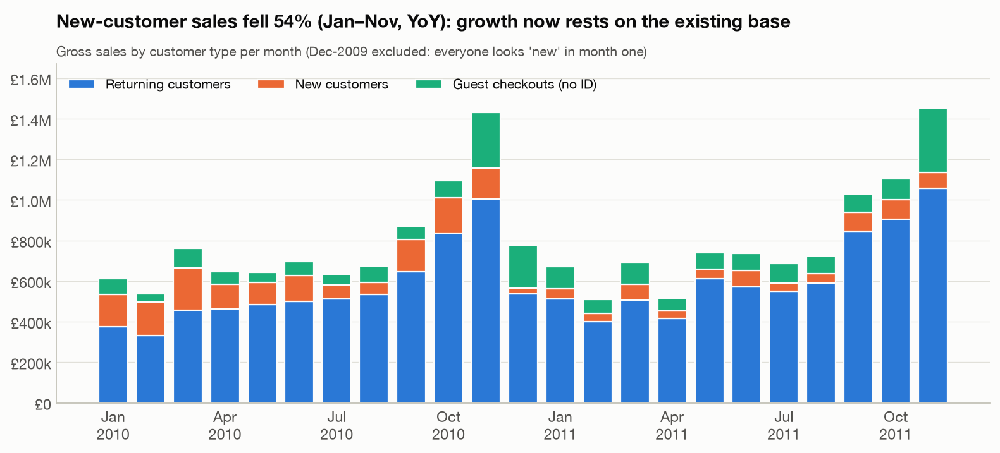
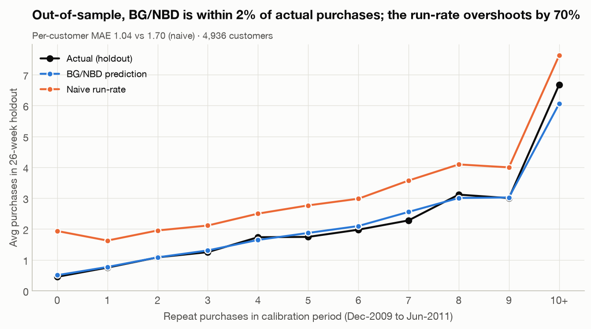
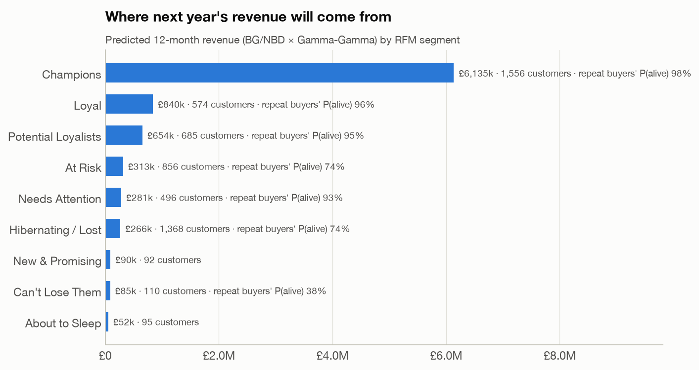
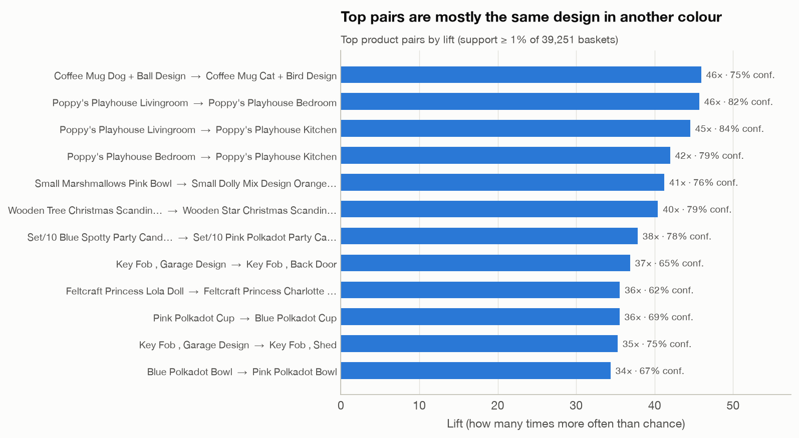
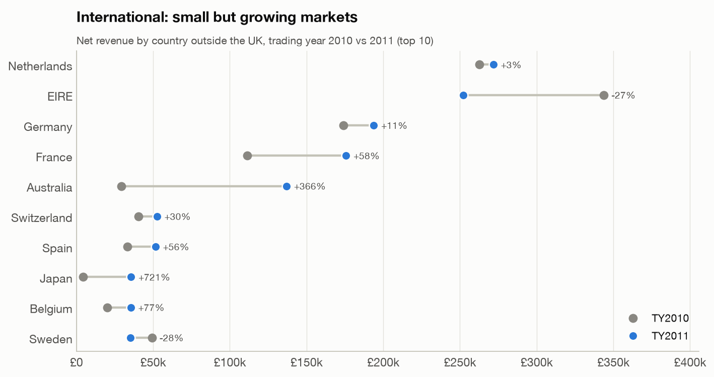
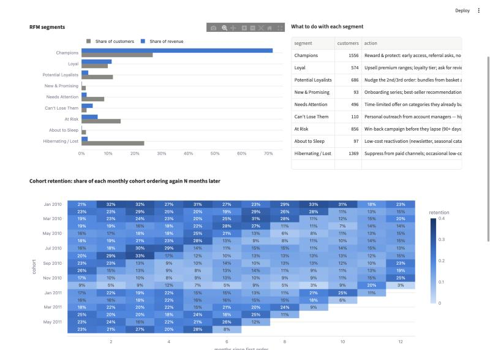

# Retail Customer & Revenue Analytics

Analysis of the UCI Online Retail II dataset: about a million transaction lines from a UK online gift shop between Dec 2009 and Dec 2011 (most of its customers are small wholesalers). I wanted to take a raw export all the way to something a business could actually use: cleaning, a SQL data model, customer segmentation, a lifetime value model, basket analysis, a weekly forecast and a dashboard.

Short version of what I found: revenue grew 1.9% to £9.33M, but it came almost entirely from existing customers. Sales to first-time customers dropped by about half, existing customers ordered slightly less often, and the newer customer cohorts are retaining worse than the year before. About a quarter of customers bring in over 70% of revenue.

- Business write-up: [reports/executive_summary.md](reports/executive_summary.md)
- Why I did things the way I did: [docs/methodology.md](docs/methodology.md)
- Metric definitions: [docs/metric_definitions.md](docs/metric_definitions.md)
- Step-by-step notebook: [notebooks/retail_analytics_walkthrough.ipynb](notebooks/retail_analytics_walkthrough.ipynb)

## Questions

1. Is the business growing, and what's driving revenue?
2. How loyal are customers, and who is about to stop buying?
3. What is each customer likely to be worth over the next year?
4. Which products get bought together?
5. Can weekly revenue be forecast well enough to plan stock?

## Results

| | |
|---|---|
| Data | 1,067,371 raw rows, 1,003,340 clean sale lines, 39.5k orders, 5,852 customers, 4,894 products |
| Data issues | The two sheets in the Excel file both contain 1-9 Dec 2010 (22.5k rows, £377k counted twice if you just stack them), plus 11.8k duplicate lines |
| Revenue | £9.16M to £9.33M (+1.9%). Orders per customer down from 4.29 to 4.11, average order value up from £476 to £508 |
| New customers | Sales to first-time customers down 54% (Jan-Nov 2011 vs Jan-Nov 2010) |
| Retention | About 21% of new customers order again the following month. 6-month retention fell from 22% to 17% (H1 2010 vs H1 2011 cohorts) |
| Concentration | Top 20% of customers make up 77% of revenue, top 20% of products 78% |
| Segments | "Champions" are 27% of customers and 72% of revenue |
| CLV model | Predicted 7,605 purchases in a 26-week holdout vs 7,721 actual (1.5% off), with 38% lower error per customer than a run-rate baseline |
| Baskets | 534 product-pair rules; 88% of the top 50 are the same design in a different colour or variant |
| Forecast | 13.7% WAPE vs 15.6% for "same week last year" |

## 1. Cleaning



Before any analysis I went through every column. A few things would have quietly broken the numbers:

- both sheets contain 1-9 Dec 2010, so stacking them double counts about £377k
- 11.8k exact duplicate lines
- cancellations, postage, bad debt write-offs and warehouse notes ("damaged", "found") sit in the same table as sales
- one stock code can have several different descriptions

I only removed rows that were actually wrong. Everything else got a `line_type` (sale, cancellation, non_product, ...) so the SQL filters on it explicitly. I also matched each cancellation back to the sale it reversed with `merge_asof`. That's how the two biggest lines in the data (80,995 and 74,215 units, both cancelled within minutes) net out without me deleting them by hand. The full log is in [docs/data_quality_report.md](docs/data_quality_report.md).

## 2. Revenue


The two years look almost identical, and November alone is about 1.8x an average month.


To see what was behind the growth I split the change in sales into customers x orders per customer x average order value. I used an LMDI decomposition so the parts add up to the total exactly. Customers ordering less often cost about £366k, which was covered by bigger orders, slightly more customers and more guest orders.



## 3. Customers


Customers are split into 9 RFM segments, each with a suggested action (see `SEGMENT_ACTIONS` in [segmentation.py](src/retail_analytics/segmentation.py)). I also ran k-means on the same three features as a check. The best k by silhouette score was 4, and those clusters line up with the RFM segments.


## 4. Customer lifetime value



I wrote the BG/NBD and Gamma-Gamma models myself with scipy, and there's a test that simulates customers from known parameters and checks the fit gets them back. I fitted on Dec 2009 to Jun 2011 and predicted the next 26 weeks. Two problems came up along the way:

- Without bounds, the optimiser drifted to a close to 0 and b around 10^15 and reported a better likelihood than any sensible fit. It was just floating point error. Bounding the parameters and adding a small penalty fixed it.
- With only 12 months of history the model over-predicted the next year by 54%, because customers who first bought in Q4 look like very frequent buyers. With 18 months it was within 2%.



## 5. Basket analysis



Pair rules come from a single sparse matrix product over 39k orders. Most of the strongest pairs are the same product in another colour or variant (the three Poppy's Playhouse rooms, the polka dot cups and bowls, the key fobs). People seem to buy sets, which points to "complete the set" recommendations and bundles.

## 6. Forecast


Every model is refit at each of the last 26 weeks and forecasts 1-4 weeks ahead:

| Model | WAPE | Bias |
|---|---:|---:|
| Average of seasonal naive + harmonic | 13.7% | -5.6% |
| Harmonic regression (Fourier terms + trading days) | 15.4% | -5.1% |
| Seasonal naive (same week last year) | 15.6% | -6.2% |
| Run rate (last 4 weeks) | 18.8% | -11.7% |
| Damped Holt | 18.8% | -8.5% |

Two years of data isn't much, so I mainly wanted to know whether anything beats the simple baselines. Averaging the two best models did, by about 12%.

## 7. Order timing and markets




## 8. Dashboard

`make dashboard` starts a Streamlit app on top of the DuckDB warehouse, with filters for month range, country and identified customers, plus a cross-sell lookup that uses the basket rules.




## Recommendations

1. Track new-customer acquisition as its own KPI and find out what changed in 2011, since first-time sales halved.
2. Set up a second-order campaign (reminder around day 30, offer around day 60) and test it as an A/B experiment. Only ~21% of new customers come back the next month, and the median gap between orders is 32 days.
3. Have account managers contact the 110 "Can't Lose Them" customers. They've spent £6.2k each on average, and the model puts the median repeat buyer in this group at a 38% chance of still being active.
4. Recommend the rest of a set when someone buys part of it, and try bundles.
5. Use the weekly forecast for Q4 stock and staffing, and schedule campaigns for Tue-Thu late mornings when most orders come in.
6. Find out why 13% of sales value from Spain gets cancelled, and try to capture a customer ID on guest orders (13% of sales have none).

More detail in the [executive summary](reports/executive_summary.md).

## How it's put together

```
ingest.py      xlsx -> parquet
cleaning.py    audit log + line_type flags -> clean parquet
sql/*.sql      DuckDB star schema + KPI views
revenue.py, cohorts.py, segmentation.py, clv.py, basket.py, forecasting.py
figures.py     charts in reports/figures
pipeline.py    runs all of the above and writes reports/metrics.json
```

- SQL: two fact tables (order lines, orders), three dimensions (date, product, customer) and eight analysis views. The views use CTEs, window functions (`LAG`, running sums, `ROW_NUMBER`) and `FILTER` aggregates.
- Python: pandas, numpy, scipy, statsmodels, scikit-learn, matplotlib.
- Tests: 28 pytest tests on small hand-made fixtures, so they run in a few seconds without downloading the data. They run on GitHub Actions on every push.
- All the numbers in this README come from `reports/metrics.json`, and rerunning the pipeline gives the same file.

```
sql/                    star schema (01-06) and analysis views (10-17)
src/retail_analytics/   python package
dashboard/app.py        streamlit dashboard
notebooks/              walkthrough notebook
reports/                executive summary, figures, csv tables, metrics.json
docs/                   methodology, metric definitions, data dictionary, data quality report
tests/
```

## Running it

```bash
python -m venv .venv && source .venv/bin/activate
make install     # pip install -e ".[dashboard,notebook,dev]"
make data        # downloads the dataset (~45 MB) and converts it to parquet
make all         # cleaning, warehouse, analysis, figures (~20s)
make test
make dashboard   # http://localhost:8501
```

## Data

[UCI Online Retail II](https://archive.ics.uci.edu/dataset/502/online+retail+ii), Chen, D. (2019), UCI Machine Learning Repository, [doi:10.24432/C5CG6D](https://doi.org/10.24432/C5CG6D), CC BY 4.0. `make data` downloads it; it isn't committed to the repo.

## Limitations and next steps

- The data starts in Dec 2009, so some 2010 "new" customers had probably bought before. The drop in new customers is real, but the 2010 baseline is a bit inflated.
- There's no cost data, so lifetime value is based on revenue, not margin.
- Basket rules and the retention numbers show what happens together, not what causes what. The second-order campaign would need an A/B test.
- BG/NBD gives one-time buyers a P(alive) of 1 by design. MBG/NBD would handle that better.
- Things I'd like to add: product categories from the descriptions, price elasticity per product, and a longer history for the forecast.
